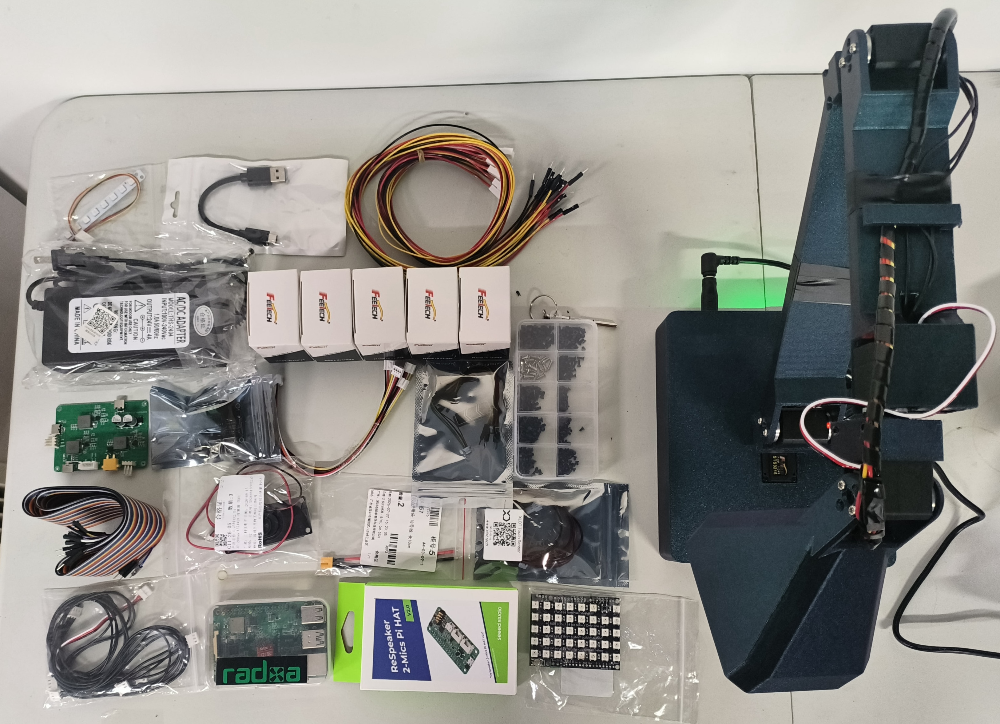

# 实验性硬件预览

[English](../hardware-preview.md) | 简体中文

下图展示了原型开发中使用的部分代表性零件和第三方模块。用于探索未来桌面具身智能体套件的原型采用五关节台灯形态，包含灯头 RGB 矩阵、底座状态灯带、触摸输入和本地计算单元。图片中可见的产品名称与商标归各自权利人所有，不代表其对 LeFly 的认可或背书。

## 硬件意向调查

我们正在向开发者、创客和教师收集非约束性意见，用于了解整机套件和自行组装套件的潜在需求。

[在飞书打开 LeFly 硬件意向调查](https://fenfsn47cp.feishu.cn/share/base/form/shrcnAMVCBg1xI04GYlUGr9x6ce)

二维码是上述直接链接的辅助入口，不是唯一访问方式。

## 未来方向

- LeFly 实体适配器或硬件 runtime；
- 物料清单；
- CAD 源文件、STL 或 3MF 文件；
- 原理图、PCB 源文件或 Gerber 文件；
- 接线或装配说明；
- LeFly Edu 的交付时间、订购入口和硬件支持承诺。
